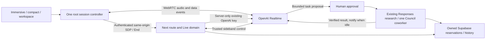

# Aethelios Live — OpenAI-native implementation and handoff

**Research addendum:** subsequent official website research verified GPT-Live documentation and `gpt-live-1`; the SDK-only availability finding below is historical and superseded. See [the multimodal roadmap](AETHELIOS_MULTIMODAL_ROADMAP.md) for the next-phase evaluation and expanded vision. The implemented pilot still uses Realtime.

October 11, 2026. Public repository: `gent-ascend-collective-app`, branch `feat/aethelios-live-openai`, base `32d1c4cffa8fe1960a97d96eca2176e16251c2e8`. User approved implementation and subsequently confirmed OpenAI-native priority. This supersedes the earlier audit's ElevenLabs-first experiment recommendation. No production deployment or merge is included.

## Executive decision

Use native OpenAI Realtime audio over browser WebRTC, with application-owned server admission and control. Keep the existing OpenAI Responses reasoning/research/Council lane for separately approved background work. One workspace controller owns all presentation modes. ElevenLabs is not required by normal conversation. Completed cinematic assets, voiceovers and the other repositories are unchanged.

This is a default-off, founder/beta-only pilot, not a production launch or measured ChatGPT Voice equivalent.

## What the audit actually found

The public baseline is Next 16.3.5 / React 19.3 / TypeScript 6 / session-bound Supabase, with OpenAI Responses through the AI SDK, NDJSON chat streaming, durable owned turns/messages, web search, Studio, Council and permission-reviewed record actions. Its orb listening/speaking states were visual previews. It has no ElevenLabs package or live conversational microphone implementation to replace. The separate private repository has an ElevenLabs integration; its founder-only privileges were not imported.

No trace or real voice recording was available to establish a measured historical voice bottleneck. Code inspection found these waits in the existing **text** path:

- `prepareReply` reserves a turn and loads context/history before generation. For older conversations, `prepareThreadSummary` can synchronously perform up to six summary batches, each allowing a 12-second model request. This is a conditional upper bound, not an observed 72-second delay.
- The configured reasoning lane defaults to `gpt-6-astra`; research and Council contributions add model/tool work. A Table waits for its selected perspectives before synthesis. Those deliberate workflows should not block the ordinary audio exchange.
- `finish` saves the response, then may await title generation (up to eight seconds) before returning the final `saved` acknowledgement. This affects completion acknowledgement, not the first streamed text.
- `frameText` paints at animation-frame cadence; inspection does not support blaming it for multi-second delays.

The native voice lane bypasses per-turn text preparation, summaries, title generation, sentence-buffered TTS and a second speech provider. Optional ASR is for the readable transcript and runs independently of direct voice-to-voice generation. Existing text behavior was preserved.

## Architecture implemented

### Native conversation and UI

- `/api/aethelios/live` exchanges the browser's SDP offer for a provider answer. Neither an API key nor an ephemeral bearer credential is returned. Provider call IDs remain server-owned; server hangup verifies an HMAC binding to owner, session and call, preventing a client-modified database call ID from targeting another call.
- Stable `gpt-realtime` is the baseline. Operator-only allowlisting also permits `gpt-realtime-1.5`, `gpt-realtime-2.1` and `gpt-realtime-mini` for later account/quality/cost comparisons. No client chooses arbitrary models or tools.
- Cedar is the initial voice choice; Marin is also selectable before connection. Voice cannot change after audio begins without ending and starting a new session. Their brand suitability and masculine presentation require actual listening evaluation; no subjective ranking is claimed.
- Semantic VAD, medium eagerness, automatic response creation and interruptions provide natural turns. There is no required push-to-talk. Browser echo cancellation/noise suppression and provider near-field noise reduction are configured; speakerphone/far-field conditions remain a device tuning gate.
- A shared provider in `Shell` survives route content and Talk drawer changes. Immersive, compact and workspace share one WebRTC connection. The existing orb has bounded audio-level reactivity and reduced-motion behavior.
- Live transcription and typed turns use the same session. Existing separate Talk requests are blocked while Live is active to avoid competing streams. Mute disables input tracks; End releases tracks and output immediately, then requests server hangup. Escape minimizes rather than ending the call.
- Connection epochs fence late microphone grants and late SDP answers. Unconfirmed server cleanup blocks another admission. Generating and playing are separate states: completed-but-buffered speech is cleared without an invalid `response.cancel`; a typed interruption waits for cancellation before requesting its next response.
- Browser hiding, page exit, offline state, track loss or connection failure stops this pilot locally and attempts server cleanup. Resume is intentional, with saved conversation context. No automatic replay of uncertain turns.

### History, authority and background work

Admission requires explicit audio/transcript consent. Optional personal context is a separate unchecked choice. Owner-scoped recent completed history, existing summary and the shared public identity/character prompt are reused, with explicit Live capability overrides. Context is seeded as ordinary untrusted messages and acknowledged by the provider before returning SDP. No private founder notebook is loaded.

The sideband processes actual provider events. ASR may arrive after `response.done`; server output drain may arrive later still. The ledger waits for required events, deduplicates provider event IDs, records failures/cancellations honestly, and excludes the unheard suffix of interrupted replies. Existing `ai_begin_turn` / `ai_finish_turn` write the same Talk history and message projection. Output-buffer drainage is not proof of physical device audibility; autoplay and actual audible cutoff remain live-device tests. Live text is labeled provisional until it appears in saved Talk history.

Background research/Council proposals are separately opt-in. Each exact task requires a human approval control. One reviewed coworker can be Athena, Prometheus, Apollo, Hermes or Themis; no invented financial Entity or unrestricted delegation. Work uses existing Responses/research/Council services, with only the approved task and no retrieved profile, memories, unrelated history or private records. Generation runs outside the voice event/persistence chain, so the microphone and ordinary turns continue. Verified results/sources are readable in Live, saved to the same conversation and supplied to Realtime as untrusted application data. Notifications wait for idle conversation rather than cutting across an active response. Session end aborts work. Two job reservations/session, twenty/day, and a 30-second job deadline bound the pilot.

Images, editing, sensitive actions, documents, memory writes and broader Entity adapters remain in their existing reviewed interfaces. A model-generated command has no privileged backend execution path. There is no automatic memory promotion.

### Cost and hosting controls

Additive RLS migration `20261011205952_aethelios_live_pilot.sql`, created with the installed Supabase CLI, adds owned session reservations and reviewed job receipts. Functions derive ownership from `auth.uid()`, reject competing active sessions, and deny ordinary direct writes. Pilot admission checks founder/beta access independently of paid membership.

Each reservation is 120 seconds, with one active session/account, ten reservations/rolling day and three starts/minute. Chat quotas still apply to persisted turns and approved results. Session reservations survive deleting the conversation; deleting the account cascades owner records. Actual aggregate provider input/output tokens are collected; late monitor totals can still update a normally ended reservation. These user-owned RPC receipts are not independently authenticated financial audit records. Detailed audio/text/cached token categories, ASR usage, host billing and invoice reconciliation are still required before paid usage policies.

The bounded server monitor runs in Next `after()` with route `maxDuration=300`, checks current session/account/grant/conversation state, and hangs up on expiry or control loss. This is **best-effort cleanup under a live function, not crash-proof expiry enforcement**. A killed process can leave a provider call running. Production admission is always rejected. Hosted preview also requires `AETHELIOS_LIVE_CONTROL_READY=true` after a documented hosting test. A longer production session needs proven independent expiry enforcement and a hosting-compatible durable control lifetime; do not assume a Next handler is an unlimited worker. No extra subscription, SDK, LiveKit deployment or agent framework was added.

## Current research evidence

Retrieved official OpenAI Node SDK `main` on October 11: `realtime.ts` blob `dbb5f247eda79e6b10f7a4d8b659ad67dea476f4`, consistent with commit `3add47071b68a05935b25d17044951a19f59c602` inspected during the audit:

- [Realtime contracts](https://github.com/openai/openai-node/blob/3add47071b68a05935b25d17044951a19f59c602/src/resources/realtime/realtime.ts): native audio, current model identifiers, Cedar/Marin recommendation, semantic VAD, transcript/function/output-buffer events, truncation and token usage. An SDK identifier does not establish account availability, pricing or production status.
- [Calls](https://github.com/openai/openai-node/blob/3add47071b68a05935b25d17044951a19f59c602/src/resources/realtime/calls.ts): multipart SDP + session creation and server hangup.
- [WebSocket transport](https://github.com/openai/openai-node/blob/3add47071b68a05935b25d17044951a19f59c602/src/realtime/websocket.ts): native WebSocket sideband `call_id` and server authentication subprotocol.
- [Realtime guidance](https://github.com/openai/openai-node/blob/3add47071b68a05935b25d17044951a19f59c602/docs/realtime.md): events, interruption and disconnect behavior; no automatic replay.

No independently verified API model named `GPT-Live` was found in those retrieved sources. Use documented Realtime identifiers rather than inventing an endpoint. Website search failed in this session; no fresh pricing-page verification is claimed. Read the matching installed Next 16.3.5 route-handler, `after`, headers and TypeScript CLI documentation, plus Supabase and React guidance. No dependency upgrades were made.

## Measurement and launch acceptance

**Real OpenAI latency, acoustic interruption delay, mobile reliability, battery impact and cost/minute: unmeasured.** The managed environment has no configured provider credentials or real devices. Unit fakes and viewport fixtures cannot establish performance parity.

Content-free browser Performance measures retain up to sixty samples/name: `aethelios-live-connect` (Start to data channel open, including permission/admission), `aethelios-live-turn` (provider speech-stopped event to output-started event), `aethelios-live-transcription` (speech-stopped to completed ASR) and `aethelios-live-local-cutoff` (event-handler/local action latency). The latter three do not independently measure acoustic end-of-speech, audibility or detector latency. Background job duration and provider aggregate tokens are stored. No transcript/owner identifiers are written into these browser metrics. Central metrics ingestion and accurate price reconciliation are not enabled.

Phase 5A replaces those initial global Performance entries with bounded per-attempt local diagnostics, matching ASR items and response timing, separate typed metrics, numeric RTC health and explicit local JSON export. See [AETHELIOS_LIVE_ACCEPTANCE.md](AETHELIOS_LIVE_ACCEPTANCE.md). The earlier global timestamp could misattribute delayed ASR; no acoustic or billing acceptance is inferred from either implementation.

Provisional targets for the first real comparison, **not measured outcomes**:

| Measure | Pilot acceptance target |
| --- | --- |
| Connection, microphone already authorized | p50 ≤3 s; p95 ≤6 s |
| Actual speech end to first audible ordinary reply | p50 ≤0.8 s; p95 ≤1.5 s |
| Actual interruption to audible silence | p95 ≤250 ms |
| Completed transcript after actual speech end | p95 ≤1 s |
| Intentional reconnect to same saved conversation | p95 ≤5 s, no duplicate replay |
| Unplanned disconnects | <1% over at least 100 representative sessions |
| Duplicate saved responses / cross-account records | Zero |
| Cost and battery | Measure before setting a commercial allowance or battery target |

Compare Cedar/Marin and account-available allowlisted models on greetings, long pauses, accents, subject changes, corrections, double-talk, interrupt-after-generation-but-before-playback-completes, approved research/Council work, provider errors and long histories. Report p50/p95 and failures on identical tasks, context sizes, network and output lengths. Capture physical/loopback audio for acoustic metrics; browser event timings alone are insufficient.

Test Samsung Galaxy Chrome/PWA, iPhone Safari/PWA, Bluetooth/headphones/speakerphone, incoming calls, app switching, screen lock, loss/recovery, low bandwidth, Fold/DeX and desktop. In-app minimization is architecturally supported; OS app switching and screen lock are explicitly foreground-stop conditions in this pilot, not claimed background capabilities. If reliable OS background voice is required, evaluate a native shell with native audio-session/lifecycle handling after these measurements.

## Validation and remaining gates

Final command results are recorded in `docs/STATUS.md`. SQL tests apply all migrations through PGlite; they do not emulate Supabase Auth or prove hosted RLS behavior.

Known environment blockers: the existing `npm run build` prebuild cannot download its pinned MediaPipe camera asset through the unavailable proxy/DNS. Direct Next build also failed because the managed Node runtime's subprocess returned empty output for TypeScript `--showConfig` (a direct compiler invocation succeeds). Default Turbopack stalled and was stopped; a webpack attempt failed at that subprocess check. No successful production build is claimed. Browser fixture serving hit loopback `EPERM`; requests for additional sandbox network permissions did not complete and were cancelled. No browser execution or screenshots are claimed. Docker access is unavailable, so real local Supabase/Auth/advisor checks are unrun. No application checks were disabled to manufacture a pass.

Before enablement: complete the production build and committed Playwright regressions in a normal runner; apply/review the additive migration on isolated Supabase and test real owner/Auth boundaries; verify SDP/context/sideband events and actual server hangup; fault-inject function death; verify model access and billing; run the real-device/voice matrix and founder evaluation. Production requires independent reliable expiry plus commercial usage/price reconciliation and action adapters. Keep ElevenLabs optional and cinematic assets intact.

Rollback: leave `AETHELIOS_LIVE_ENABLED=false`; end/drain any existing pilot calls before rotating keys. Keep the additive schema and saved history. No production deployment has been performed.

## Planning cost sensitivity

This is a hypothetical budget calculation, not verified provider pricing: 60 connected minutes/month per active voice user, including silence and tool waiting. At an assumed $0.04–$0.12/minute, native voice alone would cost approximately $240–$720 for 100 users, $2,400–$7,200 for 1,000, or $24,000–$72,000 for 10,000. The $0.08 midpoint is $480 / $4,800 / $48,000. Background reasoning/search, ASR, hosting and retained context are additional and must be measured. The two-minute pilot is a test policy, not the eventual commercial allowance.
